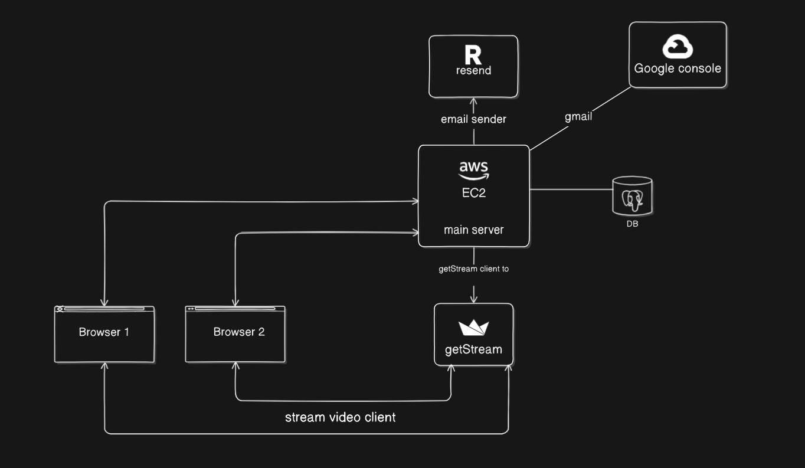

# HeyMint 💬✨
<table>
<tr>
<td>
  HeyMint is a modern video conferencing platform designed to make meetings more meaningful and effortless. Hosts can create free or protected meetings, while Stream-powered recording and transcription produce speaker-aware summaries and grounded conversational insights after each call.
</td>
</tr>
</table>

## 🚀 Features
 
 - 🔐 Access + Refresh token-based security
 
- 🧑 User management (Sign up / Login)

- 📅 Free and protected meeting scheduling

- 🧠 Speaker-aware summaries and meeting chatbot

- 🛡️ Participant-based access to protected insights

- ⚡ Fast Vite-based React frontend

- 📦 Express + Prisma backend with PostgreSQL

## 💡 Architecture





## 🛠️ Tech Stack
**Frontend**
- React (Vite)
- Tailwind CSS
- Shadcn/UI
- Framer Motion

**Backend**
- Node.js
- Express.js
- Prisma ORM

**Database**
- PostgreSQL

**Authentication**
- OTP based login (Resend)
- Google OAuth 2.0 (Passport)

**SDK Used**
- GetStream

## Meeting insights pipeline

Meeting audio is captured with Stream individual recording while Stream generates a speaker-attributed transcript. The verified Stream webhook stores a durable PostgreSQL job, and a separate worker normalizes the transcript, generates the summary, and updates the RAG index.

After configuring the backend environment from `backend/.env.example`, run:

```bash
cd backend
npx prisma migrate deploy
npm run build
```

Run the API and worker as separate processes:

```bash
npm start
npm run worker
```

Configure Stream to send video webhooks to `https://<backend-host>/api/webhooks/stream` and enable transcription for the `default` call type.


© [Abhay Pratap Singh ](https://github.com/drrakonov)

## Session and meeting lifecycle deployment

Deploy the API and frontend together. Run `npx prisma migrate deploy` before the API
starts; the lifecycle migration adds `Meeting.startedAt`, backfills existing attendance,
and separates previously completed meetings from deleted meetings. The worker should
also use the regenerated Prisma client (`npm run build`). No live database is changed
by building or running the unit tests.

- Set `BACKEND_URL` to the public HTTPS API origin and `CORS_ORIGIN` to the exact
  frontend origin (no path). Google’s authorized callback remains
  `<BACKEND_URL>/api/auth/google/callback`. Successful OAuth now returns to
  `<CORS_ORIGIN>/auth/callback` and exchanges a two-minute, single-use code bound to the browser’s verifier for an access token;
  tokens are no longer placed in redirect URLs.
- HTTPS deployments use host-only `Secure; SameSite=None` refresh cookies. Do not add
  a frontend domain to the backend cookie. Browser API requests use same-origin `/api`:
  Vite proxies to `VITE_BACKEND_URL` locally; Vercel proxies to `https://heymint.onrender.com`.
  If the production API moves, update `frontend/vercel.json`. This also keeps refresh
  cookies first-party when third-party cookies are blocked. Restart Vite after changing
  its proxy configuration. Google redirects still use `VITE_BACKEND_URL`.
- Set `TRUST_PROXY_HOPS` to the verified number of trusted reverse proxies (normally
  `1` for a direct Render web service). Keep it `0` locally. Never set blanket proxy trust.
- Subscribe the Stream video webhook to `call.session_started`, `call.session_ended`,
  `call.ended`, and the existing transcription started/ready/failed events. The last
  participant leaving completes a meeting after Stream's session inactivity timeout;
  the host leaving while others remain does not end it. Delayed events from an older
  session do not stop capture in a newer one.
- Scheduled meetings that have never started expire 24 hours after their scheduled
  time. Expiry is evaluated on requests, so no scheduler is required. Started meetings
  are exempt. Unstarted instant rooms appear in the host’s Drafts tab and can be reopened
  or deleted. Expired rooms appear in Past meetings without insight actions.

Validation: run `npm test` in each application, `npm run lint` and
`npx tsc -p tsconfig.app.json --noEmit` in the frontend, and both production builds.
Tests use in-memory service stubs and do not connect to Stream or the database.
After deployment, verify an expired access token refresh, Google login, a two-person
meeting (including host leaving first), ending a call, and summary processing in the
existing `[MeetingTrace]` logs. Real microphone, cross-site cookies, and webhook delivery
still require that deployment test.
